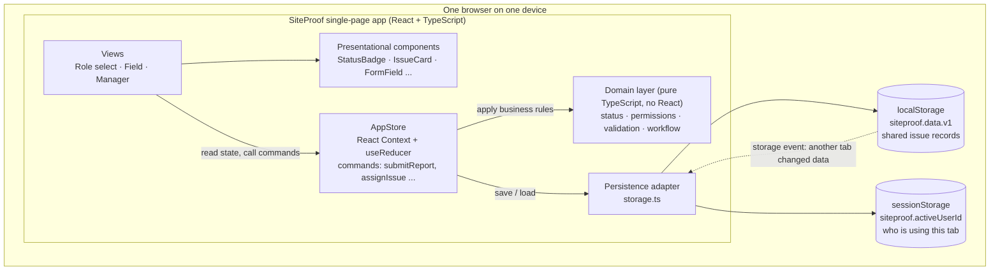
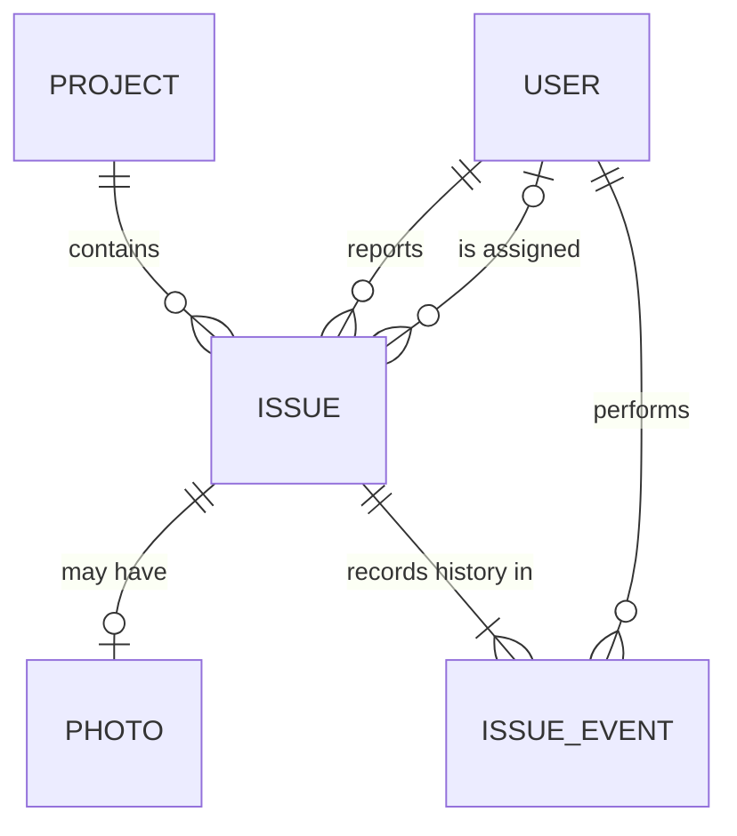
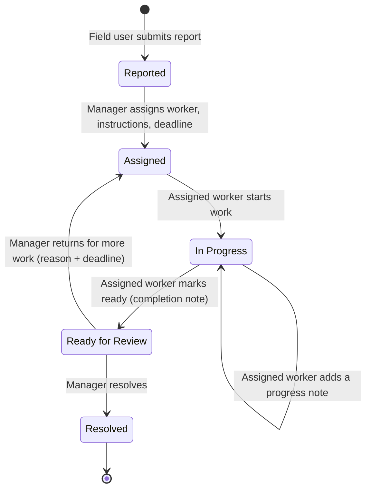
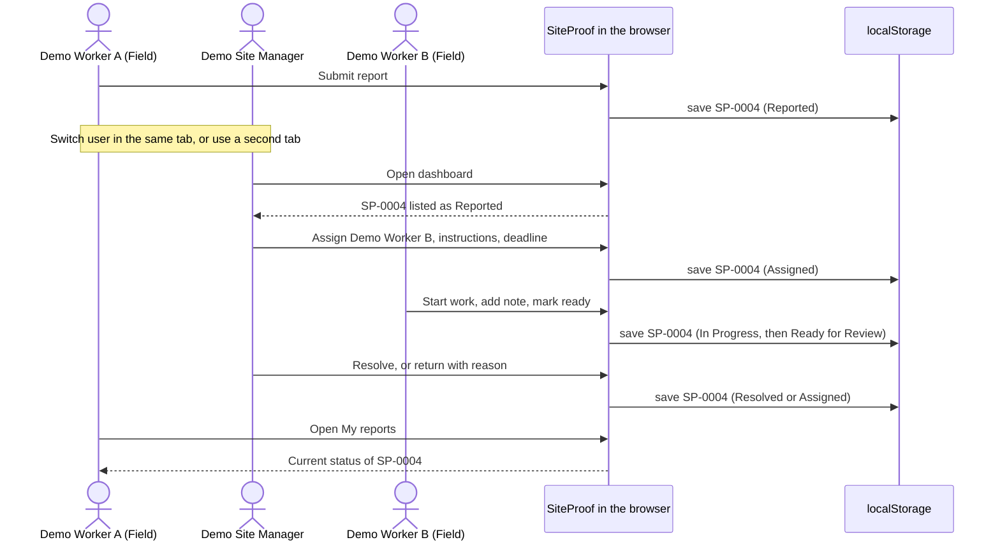
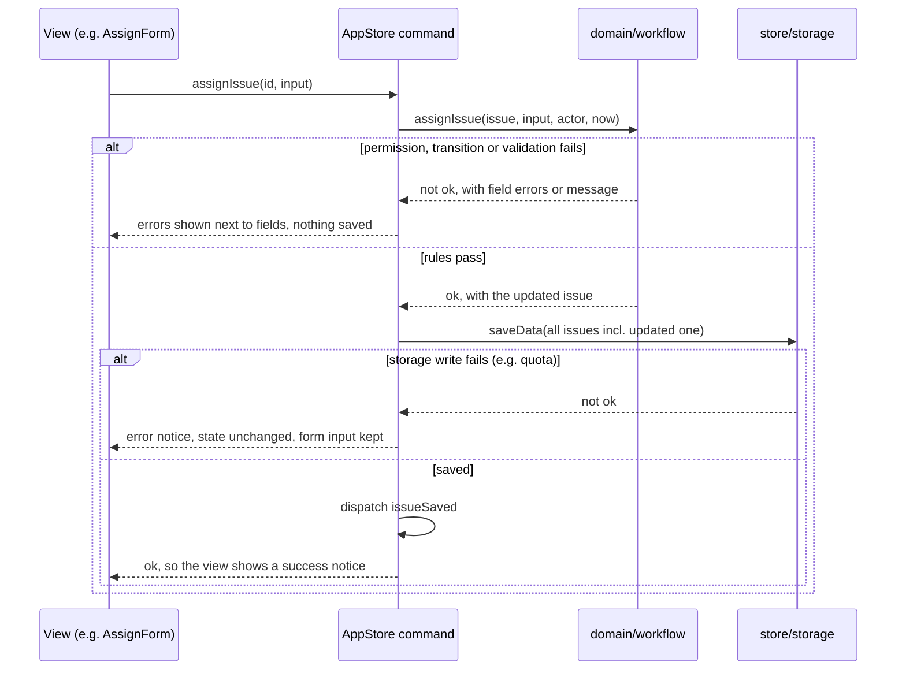

# SiteProof — Architecture

| | |
|---|---|
| **Product** | SiteProof: construction-site issue communication web app |
| **Course** | ESCP Digital Product Design, 2026–2027 |
| **Repository** | `ESCP-2627DT-A4` |
| **Prepared for** | Guillermo |
| **Document version** | 1.0, 28 October 2026 |
| **Status** | Target architecture for the functional prototype. No application code exists yet. |
| **Source of product truth** | `architecture_handoff.md`, which summarises `product.md` v5.0 (see [§1.3](#13-sources-and-how-they-were-reconciled)) |
| **Audience** | Project team, course reviewers, and AI coding agents building the prototype |

> **In one sentence:** SiteProof is a single-page web app that runs only in the browser. It keeps one shared issue record per problem in the browser's `localStorage`, and lets you switch between fictional Field and Manager users in the same browser to demonstrate the hand-off: **report → assign → progress → review**.

---

## Contents

1. [Purpose, scope and constraints](#1-purpose-scope-and-constraints)
2. [Architecture at a glance](#2-architecture-at-a-glance)
3. [Technology stack](#3-technology-stack)
4. [Project structure](#4-project-structure)
5. [Routing, views and components](#5-routing-views-and-components)
6. [Data model](#6-data-model)
7. [Issue workflow and status model](#7-issue-workflow-and-status-model)
8. [Demo role switching and permissions](#8-demo-role-switching-and-permissions)
9. [State management](#9-state-management)
10. [Local persistence](#10-local-persistence)
11. [Validation, feedback and error handling](#11-validation-feedback-and-error-handling)
12. [Photo handling](#12-photo-handling)
13. [Responsive layout and accessibility](#13-responsive-layout-and-accessibility)
14. [How to run the prototype](#14-how-to-run-the-prototype)
15. [How to test the prototype](#15-how-to-test-the-prototype)
16. [Implementation plan for agentic coding](#16-implementation-plan-for-agentic-coding)
17. [Prototype limitations](#17-prototype-limitations)

---

## 1. Purpose, scope and constraints

### 1.1 What this document is for

This document explains **how** SiteProof is built. It does not cover **what** SiteProof is (that is `product.md`) or how it looks (that is `design.md`). It is written so that a team member or an AI coding agent can build the prototype from it without having to make further architectural decisions. Every major choice comes with **why we chose it** and **why we did not choose the obvious alternatives**.

### 1.2 Constraints the architecture must respect

| # | Constraint | Consequence for the architecture |
|---|---|---|
| C1 | Functional web prototype, built with agentic coding tools | Mainstream, well-documented tools that AI agents know well. Small files with clear responsibilities. Business rules covered by tests. |
| C2 | **No external APIs** | No `fetch` calls, no third-party services, no CDNs, no web fonts, no analytics. The app works offline once installed. |
| C3 | **Fictional data only** | Fictional project, users and seed issues live in code. A visible demo banner reminds users not to enter real data or photos. |
| C4 | **Runs locally** | `npm install` and `npm run dev`, then open `localhost`. No servers, accounts or cloud setup. |
| C5 | **Communication between the two interfaces is simulated in the same browser** | Both interfaces read and write the same browser storage. Switching roles, or using a second tab, plays the part of a second person. |
| C6 | No backend and no real-time sync across devices | All data stays in one browser profile. We never claim that phones or laptops sync with each other. |
| C7 | Role switching is a demo convenience, not authentication | Permissions are UI rules that keep the demo honest. They are not security, and the document labels them that way. |
| C8 | Small and understandable beats enterprise-grade | One app with one store and one storage key. No microservices, no state-management framework, no component library. |

### 1.3 Sources and how they were reconciled

- **Primary source:** `architecture_handoff.md`. It consolidates `product.md` **v5.0** (28 October 2026): scope, FR-01 to FR-14, the status model, the permission table and the demo scenario. All requirement IDs in this document (FR-xx) refer to that numbering.
- **Older source in the repository:** `product (3).md`, which is **v1.0**, "Construction Defect Management". Where it disagrees with v5.0, v5.0 wins, because it is newer and was written specifically for the prototype. The differences that matter are listed below.

| Topic | v1.0 (`product (3).md`) | v5.0 (handoff), **used here** |
|---|---|---|
| Status names | `New → Assigned → In progress → Resolved → Closed` | `Reported → Assigned → In Progress → Ready for Review → Resolved` |
| Status mapping | New = Reported · Resolved (by assignee) = Ready for Review · Closed = Resolved | — |
| Authentication | Real authentication and secure storage | Fictional demo users, **no** real authentication |
| Filters and overdue view | Part of the MVP (FR-08) | Optional, **only after the core loop works** |
| Multiple sites | Filter by site | One fictional project (`projectId` is kept so a second project could be added later) |

> **Action for the team:** upload `product.md` v5.0 to the repository (ideally named `product.md`) so the repository matches this document.

### 1.4 In scope / out of scope

**In scope (MVP, FR-01 to FR-14):** demo user selection; issue reporting with an optional photo; issue ID and `Reported` status; manager dashboard; full issue context; assignment with instructions and a deadline; the assigned worker's task list; progress updates and *Ready for Review*; manager resolve or return-with-reason; status visibility for everyone involved; validation, empty, success and error states; persistence across refreshes in the same browser.

**Optional, only after the core loop works:** comment thread, search and filters (status, worker, deadline), more detailed activity history, overdue badge.

**Out of scope (do not build):** real accounts or authentication; backend, database or server; real-time sync across devices; push notifications or live chat; AI defect diagnosis or automatic assignment; GPS or BIM; invoices, payments or project planning; external APIs; real project data or real site photos.

> **Safety boundary (shown in the UI):** SiteProof is for routine quality, damage, workmanship and installation issues. It does not replace emergency procedures for immediately dangerous hazards, and it does not provide engineering approval, legal acceptance or compliance certification.

---

## 2. Architecture at a glance

### 2.1 Overview diagram



**A useful mental model:** each **browser tab is a person's device**, and **`localStorage` is the shared server** they all talk to. Switching the demo user in a tab is like handing the phone to a colleague.

### 2.2 Key decisions summary

Each decision is explained in detail in the section shown.

| Decision | Choice | Why | Not chosen, and why not |
|---|---|---|---|
| App type (§3) | Client-only **single-page app** | No backend allowed (C2, C6). One page lets both interfaces share one in-memory state. | *Multi-page static HTML:* state would have to be reloaded from storage on every page, and shared UI duplicated. *Server-rendered app:* needs a server we are not allowed to use. |
| UI library (§3) | **React** | The most widely used UI library, so AI agents produce reliable React code. Components map directly to our screens. Storybook supports it first-class if `design.md` needs it. | *Vanilla JS:* updating two interfaces by hand quickly becomes error-prone. *Vue / Svelte:* good, but there is no advantage for us and less agent and team familiarity. *Angular:* far too heavy for six screens. |
| Language (§3) | **TypeScript (strict)** | The status model, permissions and issue shape become types, so agent mistakes such as a misspelled status or a missing field fail at build time instead of during the demo. | *Plain JavaScript:* those mistakes only show up at runtime. |
| Build tool (§3) | **Vite** | One command scaffolds React + TypeScript. Instant dev server. Static output. Built-in CSS Modules. Vitest reuses its config. | *Next.js:* server features we must not use, plus extra concepts. *Create React App:* deprecated. *Webpack by hand:* configuration work with no benefit. |
| Routing (§5) | **React Router**, `HashRouter` | Real URLs per screen: refresh keeps you on the same screen, and the back button works. Hash URLs work on any static server with zero config. | *No router (state-based views):* refresh sends you back to the start and the back button breaks. *`BrowserRouter`:* deep links need server rewrite rules on static hosts. |
| State (§9) | **Context + `useReducer`**, with business rules in a **pure domain layer** | Built into React with no dependencies. One place where data changes. Rules are testable without the UI. | *Redux / Zustand:* extra library and concepts for one small list of issues. *`useState` in each screen:* two interfaces would get out of sync. |
| Persistence (§10) | **`localStorage`** (data) + **`sessionStorage`** (active user) | Synchronous, built in, survives refresh (FR-14). Each tab can play a different person. | *IndexedDB:* async API and more code; only worth it for large binary data. *JSON server or SQLite:* that is a backend. *Cookies:* 4 KB limit. *Firebase / Supabase:* external API. |
| Photos (§12) | **Resize in the browser → JPEG data URL** stored inside the issue | A refresh-safe local image with no server. Small enough for `localStorage`. Strips EXIF location data. | *Blob URLs:* stop working after a refresh. *Original files:* too large for storage. *File paths:* browsers do not expose them. |
| Validation (§11) | **Hand-written validator functions** shared by forms and tests | About 6 small forms, so plain functions are simpler than a library and easy for agents to read. | *Zod / Yup / React Hook Form:* extra libraries and concepts for a few rules. *Browser-only `required`:* cannot express "time or Unknown" and messages are inconsistent. |
| Styling (§13) | **Plain CSS: design tokens + CSS Modules** | Zero dependencies. Tokens map directly to `design.md`. Styles are scoped per component. | *Tailwind:* extra build setup and a second styling vocabulary next to `design.md`. *MUI / Chakra:* impose their own look and add weight. |
| Tests (§15) | **Vitest + React Testing Library**, plus a manual demo checklist | Same config as Vite. Fast. One in-memory test runs the full demo flow. | *Jest:* separate transform config for TypeScript and Vite. *Playwright / Cypress:* browser downloads and a running server. Optional later. |

---

## 3. Technology stack

### 3.1 Stack table

| Layer | Technology | Version guidance | Purpose |
|---|---|---|---|
| Runtime for tooling | **Node.js** | Current LTS, **22 or newer** (`.nvmrc` = `22`) | Runs the dev server, build and tests. Not used by the app itself. |
| Package manager | **npm** | Bundled with Node | Installs dependencies. `package-lock.json` is committed so everyone gets identical versions. |
| Build and dev server | **Vite** | Current major from `npm create vite@latest`, `react-ts` template | Dev server with hot reload. Produces static files in `dist/`. |
| UI | **React** + **ReactDOM** | Version installed by the template (React 19) | Components and rendering. |
| Language | **TypeScript** | Template default, `strict: true` | Types for the data model, statuses and permissions. |
| Routing | **React Router** (`react-router` package) | v7, used in *declarative mode* (`HashRouter`, `Routes`, `Route`) | Screen URLs, refresh-safe navigation, back button. |
| Styling | **CSS custom properties + CSS Modules** | Built into Vite | Design tokens from `design.md` and scoped component styles. |
| Unit and component tests | **Vitest**, **jsdom**, **@testing-library/react**, **@testing-library/dom**, **@testing-library/user-event**, **@testing-library/jest-dom** | Current majors | Domain unit tests, component tests, full-flow integration test. |
| Linting | **ESLint** | Config from the Vite template | Catches common React and TypeScript mistakes. |

After setup, **do not upgrade major versions** during the project. The lockfile is the source of truth for versions.

### 3.2 Why this stack fits SiteProof

1. **It matches the product's shape.** SiteProof is a small number of screens around a single shared record. A component-based single-page app keeps that record in memory and lets both interfaces render from it, so switching roles does not reload anything.
2. **It works well with agentic coding.** React, TypeScript and Vite are among the most common stacks in agents' training data and documentation. Agents produce idiomatic code with fewer mistakes, and TypeScript plus tests let the team catch the mistakes that do happen.
3. **It respects every constraint without workarounds.** The output is static HTML, CSS and JS. Everything runs on `localhost`, and nothing needs a network once dependencies are installed.
4. **It has a short path to `design.md`.** If the course requires Storybook, it can be added to a Vite + React project with one command, and our presentational components take props only (§5.4), so they can be shown in stories without the store.

### 3.3 Deliberately **not** used

| Not used | Reason |
|---|---|
| Any backend (Express, Firebase, Supabase, json-server, SQLite) | Forbidden by C2 and C6. Even a local server adds a second process to start and makes the "no backend" story less clear. |
| Next.js, Remix or other full-stack frameworks | Their main value is server rendering and server routes, which we must not use. They add concepts (server vs client components) with no benefit. |
| Redux, Zustand, MobX, TanStack Query | One list of issues does not need a state library. Query libraries exist for server data, and we have no server. |
| Component libraries (MUI, Chakra, Ant Design) | They bring their own visual language, which competes with `design.md`, and a large API surface. Our component set is small. |
| Tailwind CSS | Workable, but adds config and a utility-class vocabulary on top of `design.md` tokens. CSS Modules plus tokens are enough. |
| Form and schema libraries (React Hook Form, Formik, Zod, Yup) | About six small forms with simple rules. Plain functions are shorter and easier to test. |
| Date libraries (date-fns, Day.js, Moment) | We only compare dates and format them. `Intl.DateTimeFormat` and ISO strings cover that. |
| UUID libraries / `crypto.randomUUID()` | We use readable IDs (`SP-0007`) that people can say aloud. `crypto.randomUUID()` is also unavailable when the dev server is opened over plain `http://` on a phone on the local network. |
| Web fonts, icon CDNs, analytics | Network requests to third parties break C2 and offline use. Use the system font stack and inline SVG icons. |
| Service worker / PWA | Offline-first sync is out of scope, and service-worker caching makes demos confusing (stale versions). |

---

## 4. Project structure

The Vite app lives at the **repository root**, next to the product documents, so that `npm install` and `npm run dev` work straight after cloning.

```text
ESCP-2627DT-A4/
├── README.md                  # Overview + how to run/demo (links here)
├── product.md                 # Product requirements (v5.0)
├── evidence.md                # Research and interviews
├── design.md                  # Visual system, components, (Storybook)
├── architecture.md            # This document
├── index.html                 # Vite entry HTML (lang="en", app title)
├── package.json               # Scripts and dependencies
├── package-lock.json          # Locked versions, committed
├── vite.config.ts             # Vite + Vitest config
├── tsconfig.json              # TypeScript project references (template)
├── tsconfig.app.json
├── tsconfig.node.json
├── eslint.config.js
├── .nvmrc                     # "22"
├── .gitignore                 # node_modules, dist, coverage
└── src/
    ├── main.tsx               # Mounts <App /> and imports global CSS
    ├── App.tsx                # <AppStoreProvider> + <HashRouter> + route table
    │
    ├── domain/                # PURE TypeScript: no React, no storage, no DOM
    │   ├── types.ts           # User, Project, Issue, IssueEvent, IssueStatus ...
    │   ├── status.ts          # Status list, labels, ALLOWED_TRANSITIONS, canTransition()
    │   ├── permissions.ts     # canCreateReport(), canViewIssue(), canUpdateProgress() ...
    │   ├── validation.ts      # validateReport(), validateAssignment() ... → FieldErrors
    │   ├── workflow.ts        # createIssue(), assignIssue(), startWork() ... → Result
    │   ├── ids.ts             # nextIssueId(), nextEventId()
    │   ├── dates.ts           # todayLocal(), isFutureLocalDateTime(), formatters
    │   ├── selectors.ts       # tasksFor(), reportsBy(), countByStatus(), sortForDashboard()
    │   └── *.test.ts          # Unit tests next to each module
    │
    ├── data/
    │   └── seed.ts            # DEMO_PROJECT, DEMO_USERS, SAMPLE_ISSUES (all fictional)
    │
    ├── store/
    │   ├── storage.ts         # ONLY file that touches localStorage / sessionStorage
    │   ├── storage.test.ts
    │   └── AppStore.tsx       # Context, reducer, commands, hooks (useIssues, useActiveUser ...)
    │
    ├── lib/
    │   ├── photo.ts           # checkPhotoFile(), compressPhoto() (browser canvas)
    │   └── photo.test.ts      # Tests for the pure checks
    │
    ├── components/            # Presentational, props-only, reusable (Storybook-ready)
    │   ├── AppLayout.tsx      # Header (project, active user, Switch user) + DemoBanner + <main>
    │   ├── DemoBanner.tsx
    │   ├── StatusBadge.tsx
    │   ├── StatusCounts.tsx
    │   ├── IssueCard.tsx
    │   ├── IssueList.tsx
    │   ├── IssueSummary.tsx   # The original report, read-only
    │   ├── AssignmentSummary.tsx
    │   ├── UpdateTimeline.tsx
    │   ├── FormField.tsx      # Label + hint + control + inline error
    │   ├── ErrorSummary.tsx
    │   ├── PhotoPicker.tsx
    │   ├── EmptyState.tsx
    │   ├── Notice.tsx         # Success / info / error message
    │   └── *.module.css       # One CSS Module per component
    │
    ├── views/                 # Screens: read the store, call commands, compose components
    │   ├── RoleSelectView.tsx
    │   ├── RequireRole.tsx    # Route guard (demo convenience, not security)
    │   ├── NotFoundView.tsx
    │   ├── field/
    │   │   ├── FieldHomeView.tsx       # My Work
    │   │   ├── ReportIssueView.tsx     # Report an Issue form
    │   │   ├── FieldIssueView.tsx      # Issue / task details
    │   │   └── ProgressPanel.tsx       # Start work / add note / ready for review
    │   └── manager/
    │       ├── DashboardView.tsx
    │       ├── ManagerIssueView.tsx    # Original report + action panel + timeline
    │       ├── AssignForm.tsx
    │       └── ReviewPanel.tsx         # Resolve / Return for more work
    │
    ├── styles/
    │   ├── tokens.css         # CSS custom properties from design.md
    │   └── global.css         # Reset, base elements, focus ring, layout helpers
    │
    └── test/
        ├── setup.ts           # jest-dom matchers, cleanup, clear storage
        ├── renderApp.tsx      # Helper: render <App /> at a route with a chosen user
        └── demoFlow.test.tsx  # Full end-to-end demo scenario (§15.3)
```

### 4.1 Dependency rules

These rules keep the code understandable and make agent output predictable.

```text
views  ──►  store  ──►  domain  ◄──  lib
  │           │
  └──► components (props only)      store/storage.ts ──► browser storage
```

1. **`domain/` imports nothing from React, the DOM or storage.** It only takes data in and returns data out, so every business rule is unit-testable in milliseconds.
2. **Only `store/storage.ts` touches `localStorage` or `sessionStorage`.** If we ever change how data is stored, only that file changes.
3. **Components in `components/` never read the store.** They get everything through props. Views connect the store to components.
4. **Status and permission checks always go through `domain/status.ts` and `domain/permissions.ts`.** Components never write ad-hoc checks like `issue.status === 'assigned' && user.id === …`.

**Why this layering and not one folder per feature?** With only two interfaces and one entity, splitting by feature would scatter the single most important thing, the workflow rules, across folders. A separate `domain/` keeps all rules in one place that both interfaces share. Views are still grouped by interface (`field/`, `manager/`), so screens are easy to find.

---

## 5. Routing, views and components

### 5.1 Route table

URLs use a hash (`http://localhost:5173/#/manager/issues/SP-0004`).

| Route | View | Who can open it | Requirements |
|---|---|---|---|
| `#/` | `RoleSelectView`: choose a demo user, reset demo data | Everyone | FR-01 |
| `#/field` | `FieldHomeView`: My Work | Active user with role `field` | FR-09, FR-12, FR-13 |
| `#/field/report` | `ReportIssueView`: Report an Issue | `field` | FR-02 to FR-05, FR-13 |
| `#/field/issues/:issueId` | `FieldIssueView`: issue / task details | `field`, **and** the user is the reporter or the assignee | FR-09, FR-10, FR-12 |
| `#/manager` | `DashboardView` | Active user with role `manager` | FR-06, FR-12, FR-13 |
| `#/manager/issues/:issueId` | `ManagerIssueView`: details, assignment, review | `manager` | FR-07, FR-08, FR-11 |
| `*` | `NotFoundView` with a link home | Everyone | FR-13 |

**Route guard (`RequireRole`).** If there is no active user, redirect to `#/`. If the active user has the other role, redirect to their own home. On `FieldIssueView`, if the user is neither reporter nor assignee, show *"This issue isn't reported by or assigned to you."* with a link back. This is how *"do not show a task in an unrelated worker's task list"* also holds for direct URLs.

**Why `HashRouter` and not `BrowserRouter`?** With hash URLs, the server only ever receives `/`, so **refreshing any screen works** on the Vite dev server, `vite preview`, or any static file host such as GitHub Pages, with no rewrite configuration. `BrowserRouter` gives cleaner URLs but returns 404 on refresh on static hosts unless the server is configured. Clean URLs have no value in a demo; reliable refresh is part of FR-14's demo step 10.

**Why a router at all, and not a `currentView` state variable?** Without URLs, refresh always returns to the first screen, the browser back button leaves the app, and tests cannot open a screen directly. React Router solves all three with a few lines.

### 5.2 Field interface views (mobile-first)

**`FieldHomeView`: My Work**
- A large, full-width **Report an Issue** button at the top.
- **My assigned tasks**: issues where `assigneeId === me`. Active tasks come first, sorted by deadline (earliest first); resolved tasks come last. Each card shows the ID, title, location, status badge and deadline. If the task was returned, it also shows *"Returned for more work"*.
- **My reports**: issues where `reporterId === me`, newest first, each with its current status. This is the reporter's status view (FR-12).
- Empty states:
  - *"No tasks are assigned to you right now."*
  - *"You haven't reported any issues yet. Use **Report an Issue** when you notice something on site."*
- An issue that I both reported and am assigned to appears in both lists. This is intentional, because the two lists answer different questions.

**`ReportIssueView`: Report an Issue**
- Fields, in this order: title · category · location · description · first observed (date and time **or** "I don't know when") · suspected cause (optional) · photo (optional).
- A short safety note above the submit button: *"For immediate danger, follow your site's emergency procedures. SiteProof is not an emergency channel."*
- On success, navigate to `#/field/issues/SP-000N` with the notice *"Issue SP-000N submitted. Status: Reported. The site manager can now see it."* (FR-05).
- On validation errors, show an error summary at the top, inline messages next to each field, and keep everything the user typed, including the photo.

**`FieldIssueView`: issue / task details**
- Header: **issue ID + title + status badge** (always visible on every issue screen).
- If the issue was returned (status `assigned` and the latest event is `returned`), show a highlighted callout: *"Returned for more work: {reason}"*.
- **Assignment** (once assigned): who is responsible, deadline, manager's instructions.
- **`ProgressPanel`**: rendered **only** if `canUpdateProgress(user, issue)` is true (§8.2):
  - status `assigned`: **Start work** (optional note) → `In Progress`
  - status `in_progress`: **Add progress note** (required note, status unchanged) and **Mark ready for review** (required completion note) → `Ready for Review`
- For a reporter who is not the assignee: a read-only line, *"You reported this issue. You'll see its status here."*
- **Original report** (`IssueSummary`) and the **Updates** timeline.

### 5.3 Manager interface views (laptop-first, responsive)

**`DashboardView`**
- **Status counts** (`StatusCounts`): one tile per status showing label and number. Counts are shown as text, never by colour alone.
- **Issue list**, sorted so the things that need the manager come first:
  1. `Ready for Review` (needs a decision)
  2. `Reported` (needs assignment)
  3. `In Progress`
  4. `Assigned`
  5. `Resolved`

  Within each group, the most recently updated issue comes first.
- From 768 px wide: a semantic `<table>` with columns ID · title · location · status · assignee · deadline · last updated. Below 768 px: the same data as `IssueCard`s. Both come from the same sorted array, and CSS shows one of them. (`display: none` also removes the hidden one from the accessibility tree, so screen readers do not hear it twice.)
- Clicking a row or card opens `#/manager/issues/:id`.
- Empty state: *"No issues reported yet. Reports from the field will appear here."*

**`ManagerIssueView`: details, assignment, review**
- Header: issue ID + title + status badge.
- Two columns from 1024 px (stacked below that):
  - **Left: Original report** (`IssueSummary`): title, category, location, description, photo, reporter, first observed (or "Unknown"), reported at, and suspected cause labelled *"reporter's suspicion, not verified"* (FR-07).
  - **Right: action panel that depends on status**:

| Status | Right-hand panel |
|---|---|
| `Reported` | **`AssignForm`**: worker (select from field users), instructions (textarea), deadline (`<input type="date" min=today>`), **Assign** button. On success: *"SP-000N assigned to Demo Worker B. Due 5 Nov 2026."* |
| `Assigned` / `In Progress` | `AssignmentSummary` + *"Waiting for Demo Worker B."* No actions. |
| `Ready for Review` | `AssignmentSummary` + the worker's completion note + **`ReviewPanel`**: **Resolve** (optional note) and **Return for more work** (required reason + deadline, pre-filled if still valid). The review actions appear **only** in this status. |
| `Resolved` | Resolution summary (who, when, note). No actions. |

- Full width below: the **Updates** timeline (`UpdateTimeline`).

### 5.4 Shared components

All components in `components/` are **presentational**: they receive data and callbacks through props and never read the store. That makes them easy to reuse in both interfaces, easy to test, and ready for Storybook if `design.md` asks for it.

| Component | Responsibility | Key props |
|---|---|---|
| `AppLayout` | Header with product name, fictional project name, active demo user and role, **Switch user** button; `DemoBanner`; `<main>` landmark | `user`, `projectName`, `onSwitchUser`, `children` |
| `DemoBanner` | *"Demo prototype: fictional data only. Not a real sign-in. Do not upload real site photos."* | none |
| `StatusBadge` | Status label as **text + icon** (colour is only a supplement) | `status` |
| `StatusCounts` | Count tiles for the dashboard | `counts: Record<IssueStatus, number>` |
| `IssueCard` / `IssueList` | Compact issue entry and list, with empty state | `issue`, `users`, `href`, `showDeadline`; `issues`, `emptyMessage` |
| `IssueSummary` | Read-only original report. Shows "Unknown" for missing time or cause. | `issue`, `reporter` |
| `AssignmentSummary` | Assignee, deadline, instructions | `issue`, `assignee` |
| `UpdateTimeline` | Chronological list of `IssueEvent`s: actor, time, change, note | `events`, `users` |
| `FormField` | Label, optional hint, control, inline error; sets `aria-describedby` and `aria-invalid` | `id`, `label`, `hint`, `error`, `children` |
| `ErrorSummary` | *"Please fix 2 problems"* with links to fields; receives focus on failed submit | `errors`, `fieldOrder` |
| `PhotoPicker` | Choose a photo, preview, remove, and handle errors (§12) | `value`, `onChange`, `error` |
| `EmptyState` | Friendly message + optional action | `title`, `message`, `action` |
| `Notice` | Success / info / error message (`role="status"` or `role="alert"`) | `tone`, `children`, `onDismiss` |

---

## 6. Data model

### 6.1 Conceptual model

This is the model of the *real* domain, as described in `product.md`.



- One fictional **Project** has many **Issues**.
- Each Issue has exactly one **reporter** (User), at most one **assignee** (User), an optional **Photo**, manager instructions and a deadline, review fields, and an ordered list of **Issue Events** (status changes and progress notes).
- **Users** have a **role**: `field` (worker or quality inspector) or `manager`. "Assigned worker" is **not** a role. It is a relationship between a field user and an issue.

### 6.2 Implementation model: how the prototype stores it

The prototype **simplifies** the conceptual model in three ways. Each simplification is deliberate:

| Simplification | Why it is fine for the prototype | What a real product would do |
|---|---|---|
| **Users and the project are constants in `data/seed.ts`**, not stored data | There is no UI to create users or projects. Keeping them in code means they never get out of sync with stored issues. | User and project tables behind authentication |
| **Each Issue is one self-contained JSON document**. Photo and events are embedded inside it. | One write saves everything about an issue together, so nothing is half-saved. There are no joins to code. Tens of issues are tiny. | Separate tables or collections, photos in file storage |
| **All issues are saved together** under one storage key | Saving is a single synchronous `setItem`. The whole state is easy to inspect, reset and test. | Per-record writes through an API |

### 6.3 TypeScript types (`src/domain/types.ts`)

```ts
export type Role = 'field' | 'manager';

export interface User {
  id: string;          // 'u-worker-a'
  name: string;        // 'Demo Worker A'
  role: Role;
  jobTitle: string;    // 'Construction worker' | 'Quality inspector' | 'Site manager'
}

export interface Project {
  id: string;          // 'prj-demo'
  name: string;
}

export type IssueCategory = 'workmanship' | 'installation' | 'damage' | 'other';

export type IssueStatus =
  | 'reported'
  | 'assigned'
  | 'in_progress'
  | 'ready_for_review'
  | 'resolved';

export interface IssuePhoto {
  dataUrl: string;     // compressed JPEG, 'data:image/jpeg;base64,...'
  fileName: string;    // original file name, display only
  width: number;       // after resizing
  height: number;
  sizeBytes: number;   // approximate size after compression
}

export type IssueEventType =
  | 'reported'
  | 'assigned'
  | 'work_started'
  | 'progress_note'
  | 'ready_for_review'
  | 'returned'
  | 'resolved';

export interface IssueEvent {
  id: string;                     // 'SP-0004-03' (issue ID + sequence)
  type: IssueEventType;
  actorId: string;                // who did it
  at: string;                     // ISO 8601 timestamp (UTC)
  note: string | null;            // progress note, completion note, return reason, review note
  fromStatus: IssueStatus | null; // null for 'reported'
  toStatus: IssueStatus;          // equals fromStatus for 'progress_note'
}

export interface Issue {
  // ── Original report: written once on submission, NEVER edited afterwards ──
  id: string;                     // 'SP-0004'
  projectId: string;
  title: string;
  category: IssueCategory;
  location: string;
  description: string;
  firstObservedAt: string | null; // 'YYYY-MM-DDTHH:mm' (local time); null if unknown
  observedTimeUnknown: boolean;
  suspectedCause: string | null;  // null = Unknown / not given
  photo: IssuePhoto | null;
  reporterId: string;
  reportedAt: string;             // ISO 8601, set by the system

  // ── Assignment ──
  status: IssueStatus;
  assigneeId: string | null;
  instructions: string | null;
  dueDate: string | null;         // 'YYYY-MM-DD' (date only)
  assignedAt: string | null;

  // ── Review ──
  reviewedBy: string | null;
  reviewedAt: string | null;
  reviewNote: string | null;      // latest decision: return reason or optional resolve note
  resolvedAt: string | null;

  // ── History ──
  updates: IssueEvent[];          // append-only, oldest first
  lastUpdatedAt: string;          // ISO 8601
}
```

**Why store status as codes (`'in_progress'`) instead of display text (`'In Progress'`)?** Codes are stable keys. The display wording lives in one map in `status.ts` (`STATUS_LABEL`), so the UI wording can change without migrating stored data.

### 6.4 Field rules

| Field | Required | Rule | Set by |
|---|---|---|---|
| `id` | auto | `SP-` + 4 digits, unique (§6.6) | System on submit |
| `title` | yes | 3–80 characters after trimming | Reporter |
| `category` | yes | one of `workmanship`, `installation`, `damage`, `other` | Reporter |
| `location` | yes | 3–120 characters, e.g. *"Building A, Floor 2, Apartment 2.04, bathroom"* | Reporter |
| `description` | yes | 10–1000 characters | Reporter |
| `firstObservedAt` / `observedTimeUnknown` | one of the two | valid local date-time **not in the future**, **or** `observedTimeUnknown = true` (then `firstObservedAt = null`) | Reporter |
| `suspectedCause` | no | ≤ 300 characters; empty → `null`, shown as **"Unknown"** | Reporter |
| `photo` | no | image, ≤ 15 MB before compression, ≤ 800 KB after (§12) | Reporter |
| `reporterId`, `reportedAt`, `projectId` | auto | active user, now, demo project | System |
| `assigneeId` | for assignment | must be an existing `field` user | Manager |
| `instructions` | for assignment | 10–1000 characters | Manager |
| `dueDate` | for assignment and return | valid `YYYY-MM-DD`, **≥ today** (so never before the assignment date) | Manager |
| `reviewNote` | for return | return reason 10–500 characters; resolve note optional, ≤ 500 | Manager |
| Progress / completion notes | see §7.2 | ≤ 500 characters | Assigned worker |

**Date and time conventions** (`src/domain/dates.ts`):
- **System timestamps** (`reportedAt`, `assignedAt`, event `at`, ...) use `new Date().toISOString()`. Unambiguous, sortable, JSON-safe.
- **`firstObservedAt`** keeps the value of `<input type="datetime-local">` as entered (local wall-clock time). There is one site in one time zone, so converting it would only add bugs.
- **`dueDate`** is date-only (`<input type="date">`), because deadlines on site are days, not minutes. Compare due dates as strings (`'2026-11-05' >= '2026-10-28'`) against `todayLocal()`, which returns the **local** date (not `toISOString().slice(0, 10)`, which returns the UTC date).
- **Formatting** uses `Intl.DateTimeFormat`. Display a `dueDate` by building `new Date(year, month - 1, day)`. **Never** use `new Date('2026-11-05')`, which is parsed as UTC midnight and can show the previous day.
- **Why no date library?** We need two comparisons and two formatters. The platform's built-in date APIs (`Intl.DateTimeFormat`, ISO strings) already do that.

### 6.5 Fictional seed data (`src/data/seed.ts`)

| ID | Name | Role | Job title |
|---|---|---|---|
| `u-worker-a` | Demo Worker A | `field` | Construction worker |
| `u-worker-b` | Demo Worker B | `field` | Construction worker |
| `u-inspector` | Demo Inspector | `field` | Quality inspector |
| `u-manager` | Demo Site Manager | `manager` | Site manager |

- **Project:** `{ id: 'prj-demo', name: 'Maple Court Residences (fictional demo project)' }`
- **Sample issues** (loaded on first start and by *Restore sample issues*):
  - `SP-0001` · `Reported` · reported by Demo Inspector · damage · time observed unknown · no photo
  - `SP-0002` · `In Progress` · reported by Demo Inspector · assigned to Demo Worker A · installation
  - `SP-0003` · `Resolved` · reported by Demo Worker A · assigned to Demo Worker A · workmanship
- **Demo Worker B has no tasks at the start**, so the demo can show the empty state first and then the newly assigned task (§15.3, step 6).
- Seed issues have **no photos**, to keep the seed small and to guarantee that no real images are in the repository.

All assignable workers come from `DEMO_USERS.filter(u => u.role === 'field')`. That includes the inspector, because `product.md` allows an assignee to be *"an existing worker or another authorized team member"*.

### 6.6 Identifiers

- **Issue IDs:** `nextIssueId(issues)` returns `SP-` + (highest existing number + 1), zero-padded to 4 digits: `SP-0004`.
  - *Why readable sequential IDs?* SiteProof is about communication. People must be able to say *"SP-0004 is ready"* on site.
  - *Why compute from existing issues and not keep a separate counter?* There is no counter that can drift out of sync. Issues are never deleted in the MVP, so the result is always unique. Only *Clear all issues* (a demo reset) restarts at `SP-0001`.
- **Event IDs:** `nextEventId(issue)` returns `${issue.id}-${n}`, e.g. `SP-0004-03`. Unique within the issue, deterministic in tests.

### 6.7 Persisted document (example)

```json
{
  "schemaVersion": 1,
  "issues": [
    {
      "id": "SP-0004",
      "projectId": "prj-demo",
      "title": "Gap between window frame and wall",
      "category": "installation",
      "location": "Building A, Floor 2, Apartment 2.04, bedroom window",
      "description": "Visible gap of about 5 mm on the left side of the frame. Daylight shows through.",
      "firstObservedAt": "2026-10-28T08:30",
      "observedTimeUnknown": false,
      "suspectedCause": null,
      "photo": null,
      "reporterId": "u-worker-a",
      "reportedAt": "2026-10-28T09:02:11.000Z",
      "status": "assigned",
      "assigneeId": "u-worker-b",
      "instructions": "Remove trim, refill gap with expanding foam, re-seal and refit trim.",
      "dueDate": "2026-10-30",
      "assignedAt": "2026-10-28T09:15:40.000Z",
      "reviewedBy": null,
      "reviewedAt": null,
      "reviewNote": null,
      "resolvedAt": null,
      "updates": [
        { "id": "SP-0004-01", "type": "reported", "actorId": "u-worker-a", "at": "2026-10-28T09:02:11.000Z", "note": null, "fromStatus": null, "toStatus": "reported" },
        { "id": "SP-0004-02", "type": "assigned", "actorId": "u-manager", "at": "2026-10-28T09:15:40.000Z", "note": null, "fromStatus": "reported", "toStatus": "assigned" }
      ],
      "lastUpdatedAt": "2026-10-28T09:15:40.000Z"
    }
  ]
}
```

---

## 7. Issue workflow and status model

### 7.1 State diagram



### 7.2 Transition table (`src/domain/status.ts` + `src/domain/workflow.ts`)

```ts
export const ALLOWED_TRANSITIONS: Record<IssueStatus, IssueStatus[]> = {
  reported:         ['assigned'],
  assigned:         ['in_progress'],
  in_progress:      ['ready_for_review'],
  ready_for_review: ['resolved', 'assigned'],
  resolved:         [],
};
export const canTransition = (from: IssueStatus, to: IssueStatus) =>
  ALLOWED_TRANSITIONS[from].includes(to);
```

| Workflow function | From → To | Who (permission) | Required input | Fields written | Event |
|---|---|---|---|---|---|
| `createIssue` | (new) → `reported` | field user (`canCreateReport`) | report fields | all original-report fields, `status`, `lastUpdatedAt` | `reported` |
| `assignIssue` | `reported` → `assigned` | manager (`canAssign`) | worker, instructions, deadline | `assigneeId`, `instructions`, `dueDate`, `assignedAt` | `assigned` |
| `startWork` | `assigned` → `in_progress` | assignee (`canUpdateProgress`) | note optional | none | `work_started` |
| `addProgressNote` | `in_progress` → `in_progress` | assignee (`canUpdateProgress`) | note **required** | none | `progress_note` |
| `markReadyForReview` | `in_progress` → `ready_for_review` | assignee (`canUpdateProgress`) | completion note **required** | none | `ready_for_review` |
| `resolveIssue` | `ready_for_review` → `resolved` | manager (`canReview`) | note optional | `reviewedBy`, `reviewedAt`, `reviewNote`, `resolvedAt` | `resolved` |
| `returnForWork` | `ready_for_review` → `assigned` | manager (`canReview`) | reason **required** + deadline ≥ today | `reviewedBy`, `reviewedAt`, `reviewNote` (= reason), `dueDate` | `returned` |

Every workflow function also sets `status` (where it changes), appends exactly one `IssueEvent` and updates `lastUpdatedAt`.

**Every workflow function has the same shape:**

```ts
type Result =
  | { ok: true; issue: Issue }
  | { ok: false; fieldErrors?: FieldErrors; message?: string };

// e.g.
assignIssue(issue: Issue, input: AssignmentInput, ctx: { actor: User; now: Date }): Result
```

Each function runs four steps in this order:

1. **Permission:** `canAssign(actor, issue)`. If false, return `{ ok: false, message: 'Only the site manager can assign issues.' }`.
2. **Transition:** `canTransition(issue.status, 'assigned')`. If false, return `{ ok: false, message: 'SP-0004 is already In Progress and can't be assigned again.' }`.
3. **Validation:** `validateAssignment(input, now)`. If there are errors, return `{ ok: false, fieldErrors }`.
4. **Build:** return a **new** `Issue` object. The input is never mutated.

`now` is passed in, never read inside the function, so tests can use a fixed date.

**Why put these rules in pure functions and not inside the components or the reducer?** The same rule protects both interfaces. A Field screen and a Manager screen cannot disagree about what is allowed, and every rule can be tested with a one-line call and no rendering.

### 7.3 Rules that must always hold

- **The original report is immutable.** No function changes `title`, `category`, `location`, `description`, `firstObservedAt`, `observedTimeUnknown`, `suspectedCause`, `photo`, `reporterId` or `reportedAt` after `createIssue`. Assignment, progress and review are *added* on top (product principle: *"preserve the original report"*).
- **Returning an issue keeps the same ID, report, assignee and instructions.** Only the status (back to `assigned`), the deadline and the review fields change, and the reason is recorded in `reviewNote` and in the `returned` event. The worker sees the reason in the callout (§5.2).
  - *Why must a new deadline be entered when returning?* The original deadline may already be in the past, which would make the returned task overdue the moment it is returned. The field is pre-filled with the old date if it is still valid. This is also how the manager can *"set/change deadline"* (permission table) without a separate edit feature.
- **The manager cannot resolve before `Ready for Review`.** This is enforced by `canTransition` and `canReview`, and the Resolve button does not render in any other status.
- **`Resolved` is final in the MVP.** There is no reopen. If needed later, add `reopenIssue` with its own transition and test.
- **Reassignment is not in the MVP.** If the team needs it later, add `reassignIssue` (manager only, status `assigned`) with the same validation as `assignIssue`.

### 7.4 Status presentation

| Code | Label (`STATUS_LABEL`) | Shown with | Meaning shown to users |
|---|---|---|---|
| `reported` | Reported | icon + text | Waiting for the site manager |
| `assigned` | Assigned | icon + text | A worker is responsible and has a deadline |
| `in_progress` | In Progress | icon + text | The worker has started |
| `ready_for_review` | Ready for Review | icon + text | The worker says the fix is done; the manager decides |
| `resolved` | Resolved | icon + text | The manager accepted the work (demo, not formal approval) |

Badge colours come from `design.md` tokens, but **the text label is always visible**, so status never depends on colour alone.

---

## 8. Demo role switching and permissions

### 8.1 How role switching works

1. `#/` (`RoleSelectView`) lists the four demo users as large buttons, grouped as **Field** (Workers, Inspector) and **Manager**, under the heading *"Choose a demo user (no password, fictional people only)"*.
2. Choosing a user calls `switchUser(userId)`. This saves the ID in **`sessionStorage`** (`siteproof.activeUserId`), updates the store, and navigates to `#/field` or `#/manager`.
3. Every screen shows the active user and role in the header, with a **Switch user** button that returns to `#/`.
4. Switching user **never touches issue data** (FR-01). Issues live in `localStorage`, separate from the active user.

**Why `sessionStorage` for the active user and `localStorage` for issues?**
- `sessionStorage` is **per tab** and **survives refresh**. A refresh keeps you as the same person (demo step 10). Two tabs can be two different people at the same time, for example a phone-sized Field tab next to a Manager tab during the presentation. That makes the *"two interfaces communicating in one browser"* visible.
- Issues must be **shared by all tabs** and survive closing the browser, so they belong in `localStorage`.
- *Why not keep the active user in `localStorage` too?* Then every tab would always be the same person, and switching in one tab would silently switch the other.

### 8.2 Permission functions (`src/domain/permissions.ts`)

These implement the permission table from `product.md`:

| Action | Field reporter | Assigned worker | Site manager | Function |
|---|---|---|---|---|
| Create report | Yes | Yes | Not in MVP | `canCreateReport(user)` → `user.role === 'field'` |
| View an issue | Own reports | Own tasks | All | `canViewIssue(user, issue)` → manager, or reporter, or assignee |
| Assign worker, set deadline | No | No | Yes | `canAssign(user, issue)` → manager **and** status `reported` |
| Update progress | Only if assignee | Yes | No | `canUpdateProgress(user, issue)` → field **and** `issue.assigneeId === user.id` **and** status ∈ {`assigned`, `in_progress`} |
| Resolve / return for work | No | No | Yes | `canReview(user, issue)` → manager **and** status `ready_for_review` |

**Each rule is used in two places:**
1. **In views**, to decide what to render. For example, `ProgressPanel` only renders if `canUpdateProgress` is true.
2. **In workflow functions**, which reject the action if the rule fails, even if a button was somehow visible.

**Why check twice?** The UI check gives a clean experience. The workflow check guarantees the demo cannot reach an impossible state, even through a stale tab or a test.

### 8.3 What this is **not**

> ⚠️ **Demo role switching is not authentication or authorization.** Anyone using the browser can pick any user, and anyone can edit `localStorage` in DevTools. The permission functions keep the *demo workflow* correct; they do **not** protect data. A real product would need real accounts, server-side authorization and secure photo storage (see `product.md` non-functional requirements). The UI says this in the `DemoBanner`.

### 8.4 How the two interfaces "communicate"



- **Same tab:** all screens render from the same in-memory store, so a change is visible as soon as you switch user.
- **Two tabs:** when one tab writes to `localStorage`, the browser fires a `storage` event in **other tabs** of the same origin. `storage.ts` listens for it and the store replaces its issues (§10.4). The other tab updates within milliseconds, with no polling.
- **Two devices:** **no communication.** Each device has its own storage. The prototype never claims otherwise.

---

## 9. State management

### 9.1 Store shape (`src/store/AppStore.tsx`)

```ts
interface AppState {
  issues: Issue[];
  activeUserId: string | null;
  storage: {
    persistent: boolean;     // false if browser storage is unavailable
    notice: string | null;   // e.g. "Saved demo data couldn't be read and was reset."
  };
}

type AppAction =
  | { type: 'issueSaved'; issue: Issue }          // insert or replace by id
  | { type: 'issuesReplaced'; issues: Issue[] }   // reset demo, or change from another tab
  | { type: 'activeUserChanged'; userId: string | null }
  | { type: 'storageNoticeDismissed' };
```

The **reducer is deliberately simple**: it only puts already-validated data into state. All decisions happen in the domain layer *before* dispatch.

### 9.2 Commands: the only way to change data

`useIssueActions()` returns these functions. Views call them; views never call `dispatch` directly.

| Command | Calls | Returns |
|---|---|---|
| `submitReport(input)` | `workflow.createIssue` | `CommandResult` (with the new issue) |
| `assignIssue(issueId, input)` | `workflow.assignIssue` | `CommandResult` |
| `startWork(issueId, note?)` | `workflow.startWork` | `CommandResult` |
| `addProgressNote(issueId, note)` | `workflow.addProgressNote` | `CommandResult` |
| `markReadyForReview(issueId, note)` | `workflow.markReadyForReview` | `CommandResult` |
| `resolveIssue(issueId, note?)` | `workflow.resolveIssue` | `CommandResult` |
| `returnForWork(issueId, input)` | `workflow.returnForWork` | `CommandResult` |
| `switchUser(userId \| null)` | `storage.saveActiveUserId` | `void` |
| `resetDemoData('sample' \| 'empty')` | `storage.saveData` | `CommandResult` |

Every issue command follows the same steps. This is **write-through persistence**: nothing reaches the screen as "saved" unless it really was saved.



**Why save *before* updating state, rather than saving in a `useEffect` after every state change?** With an effect, the UI would already say *"Issue submitted"* when the save might still fail, for example because a photo filled up storage. Product rule: *"reports and photos must not be silently lost; submission failures must be clear."* Saving first means success messages are always true.

### 9.3 Reading state: hooks and selectors

- `useActiveUser(): User | null`
- `useIssues(): Issue[]` and `useIssue(id): Issue | undefined`
- `useStorageStatus()`
- Derived lists come from **pure selectors** in `domain/selectors.ts`: `tasksFor(issues, userId)`, `reportsBy(issues, userId)`, `countByStatus(issues)`, `sortForDashboard(issues)`, `isReturned(issue)`.

Selectors are computed during render. **Why no memoisation library?** With tens of issues, sorting and filtering takes microseconds. Add `useMemo` only if profiling shows a need.

### 9.4 Local UI state

These things are **not** in the store:
- **Form inputs and form errors:** `useState` inside the form. They belong to one screen only and must survive a failed submit.
- **Success notices:**
  - After navigating, pass the notice through React Router location state: `navigate(path, { state: { notice } })`. The target view renders `<Notice>` if `location.state?.notice` is set.
  - After an in-place action (assign, review), keep the notice in the view's own `useState`.
- **Photo preview:** inside `PhotoPicker` until submit.

**Why not put notices in the global store?** They are short-lived and belong to one screen. A global queue would need clearing logic for no benefit.

### 9.5 Why not other state approaches

| Option | Why not for SiteProof |
|---|---|
| Redux Toolkit | Solves large-team, many-slice problems we don't have. Adds a dependency and concepts (slices, thunks) for one list of issues. |
| Zustand | Lighter than Redux, but still a dependency doing what `useReducer` + Context already does. |
| `useState` in each view | Field and Manager views would hold separate copies and drift apart. Switching roles would show stale data. |
| Reading `localStorage` directly in every component | Scatters storage logic. No single place for validation or error handling. Hard to test. |

---

## 10. Local persistence

### 10.1 What is stored where

| Key | Storage | Content | Lifetime |
|---|---|---|---|
| `siteproof.data.v1` | `localStorage` | `{ schemaVersion: 1, issues: Issue[] }` | Until **Reset demo data** or the browser's site data is cleared |
| `siteproof.activeUserId` | `sessionStorage` | `"u-worker-a"` etc. | Until the tab is closed (survives refresh) |
| `siteproof.data.backup` | `localStorage` | Raw text of unreadable data, kept by the recovery step (§10.3) | Overwritten by the next recovery |

Users and the project are **not** stored. They come from `data/seed.ts` (§6.2).

### 10.2 `storage.ts` API

```ts
export const DATA_KEY = 'siteproof.data.v1';
export const USER_KEY = 'siteproof.activeUserId';
export const SCHEMA_VERSION = 1;

export type LoadResult =
  | { status: 'loaded'; issues: Issue[] }      // normal case
  | { status: 'seeded'; issues: Issue[] }      // first visit: sample issues written
  | { status: 'recovered'; issues: Issue[] }   // unreadable data backed up, sample issues used
  | { status: 'unavailable'; issues: Issue[] } // storage blocked: works in memory only

export function loadData(): LoadResult;
export function saveData(issues: Issue[]): { ok: true } | { ok: false; reason: 'quota' | 'unavailable' };
export function loadActiveUserId(): string | null;
export function saveActiveUserId(id: string | null): void;
export function subscribeToOtherTabs(onChange: (issues: Issue[]) => void): () => void;
```

### 10.3 Loading on start-up

1. Try to read `siteproof.data.v1`. If `localStorage` throws (storage disabled, some private modes), return `unavailable` with the sample issues. The app shows a persistent notice: *"Your browser is blocking storage. Changes will be lost on refresh."*
2. **No value** (first visit): write the sample issues and return `seeded`.
3. **Value present:** `JSON.parse` it and run a light structural check: `schemaVersion === 1`, `issues` is an array, and each item has a string `id` and a known `status`.
   - **Passes:** return `loaded`.
   - **Fails** (corrupt JSON, old schema): copy the raw text to `siteproof.data.backup`, write the sample issues, return `recovered`. The app shows *"Saved demo data couldn't be read and was reset."*

   Nothing is silently destroyed.
4. Read `siteproof.activeUserId`. If it does not match a demo user, ignore it and show the role selector.

**Why a light check and not a full schema validator?** The only writer is our own code. The check exists to survive manual edits in DevTools and schema changes during development, not hostile input. A schema library would be a dependency for one function.

**Schema changes during development.** If the `Issue` shape changes incompatibly, bump `SCHEMA_VERSION` and the key (`siteproof.data.v2`). Old fictional data is then replaced by the seed with a notice. Migrations are not worth writing for demo data.

### 10.4 Saving and cross-tab updates

- `saveData` serialises `{ schemaVersion, issues }` and calls `localStorage.setItem` inside `try/catch`.
  - A `QuotaExceededError` (Firefox: `NS_ERROR_DOM_QUOTA_REACHED`) returns `{ ok: false, reason: 'quota' }`.
  - The command (§9.2) then shows: *"Couldn't save. Browser storage is full. Remove the photo or reset the demo data, then try again."* The form keeps its input.
- `subscribeToOtherTabs` listens for `window`'s `storage` event:
  - If `event.key === DATA_KEY`, parse `event.newValue` and dispatch `issuesReplaced`.
  - If `event.key === null` (storage cleared elsewhere), reload from storage.

  The event only fires in **other** tabs, never in the tab that wrote, so there is no feedback loop.
- **Conflicts:** commands always work on the tab's current in-memory issues, which the `storage` event keeps up to date. If a screen becomes stale (another tab changed the status), the workflow function rejects the action with a clear message, e.g. *"SP-0004 is now Ready for Review."*, and the view re-renders with the current state. For a demo with one presenter this is sufficient.

### 10.5 Reset demo data

`RoleSelectView` has a small **Demo data** section with two buttons, each confirmed with `window.confirm`:
- **Restore sample issues:** replace all issues with `SAMPLE_ISSUES`.
- **Clear all issues:** start empty. Useful for showing empty states. IDs restart at `SP-0001`.

**Why `window.confirm` instead of a custom dialog?** It is native, keyboard and screen-reader accessible, and needs no code. This is a presenter tool, not part of the product experience.

### 10.6 Storage budget

- Browsers typically allow **about 5 MB per origin** in `localStorage`. The exact limit depends on the browser.
- Text issues are around 2 KB each. Compressed photos are usually **150–300 KB** (§12). That leaves room for roughly 15–25 photos plus hundreds of text-only issues, which is more than any demo needs.
- **Why not IndexedDB, which allows much more space?** Its asynchronous API would turn every save into a promise, complicate the write-through flow, and roughly double the persistence code. If the team ever needs many photos, swapping `storage.ts` to IndexedDB is the upgrade path, and nothing outside `storage.ts` would need to change (§4.1, rule 2).

---

## 11. Validation, feedback and error handling

### 11.1 Principles

- **One set of rules** in `domain/validation.ts`, used by the forms (for messages) and by workflow functions (as a safety net), and tested directly.
- **Validate on submit, then live.** No red errors while the user is still typing for the first time. After a failed submit, each field re-validates as it changes, so the message disappears as soon as the field is fixed.
- **Plain-language messages** that say what to do, placed **next to the field**, plus an **error summary** at the top.
- **Forms use `noValidate`.** We show our own messages instead of the browser's inconsistent pop-ups. We still use the correct input types (`date`, `datetime-local`, `file`) and attributes (`min`, `maxLength`) for good mobile keyboards and pickers.

**Why not rely on HTML `required` alone?** It cannot express *"a date-time **or** Unknown"* or *"not in the future"*. Its messages differ between browsers and languages. It also cannot be unit-tested.

### 11.2 Validators and messages

`type FieldErrors = Partial<Record<string, string>>` maps a field name to a message.

**`validateReport(input, now)`**

| Field | Message |
|---|---|
| title | *Enter a short title (3–80 characters).* |
| category | *Choose a category.* |
| location | *Enter where the issue is, e.g. "Building A, Floor 2, Room 2.04".* |
| description | *Describe what you see (at least 10 characters).* |
| firstObservedAt | *Enter when you first noticed the issue, or choose "I don't know when".* / *This time is in the future.* |
| suspectedCause | *Keep the suspected cause under 300 characters.* (optional field) |

**`validateAssignment(input, now)`**

| Field | Message |
|---|---|
| assigneeId | *Choose who will fix this.* |
| instructions | *Write instructions for the worker (at least 10 characters).* |
| dueDate | *Choose a deadline of today or later.* |

**Progress and review validators**

| Validator | Rule |
|---|---|
| `validateProgressNote` | required, 1–500 characters |
| `validateCompletionNote` | required, 3–500 characters: *Describe what was done.* |
| `validateReturn` | reason required, 10–500 characters: *Explain what still needs to be done.* Deadline as in `validateAssignment`. |
| Resolve note, start-work note | optional, ≤ 500 characters |

The "Unknown" options are UI controls that write `observedTimeUnknown = true` or `suspectedCause = null`:
- **"I don't know when"** is a checkbox that disables and clears the date-time input.
- **Suspected cause** is a plain optional text field with the hint *"Leave empty if you don't know. That's fine."*

The cause is **never** required, so a reporter is never pushed to invent one (FR-04).

### 11.3 Error display pattern (accessible)

- Every input sits inside `FormField`. A visible `<label>`, an optional hint, and the error are linked with `aria-describedby`. A field with an error has `aria-invalid="true"`.
- On a failed submit, `ErrorSummary` (`role="alert"`, *"Please fix 2 problems"*, with links that move focus to each field) receives focus, so keyboard and screen-reader users know what happened.
- Radio and checkbox groups use `<fieldset>` + `<legend>`.

### 11.4 Feedback for every outcome

| Situation | What the user sees |
|---|---|
| Report submitted | Success notice with the ID and status: *"Issue SP-0004 submitted. Status: Reported."* (FR-05) |
| Issue assigned | *"SP-0004 assigned to Demo Worker B. Due 30 Oct 2026."* |
| Work started / note added / ready for review | *"Status updated: In Progress."* / *"Note added."* / *"Marked ready for review. The site manager will check it."* |
| Resolved / returned | *"SP-0004 resolved."* / *"SP-0004 returned to Demo Worker B with your reason."* |
| Validation failure | Error summary + inline messages; input kept |
| Action no longer allowed (stale screen, wrong role) | Error notice with the current status; the screen re-renders |
| Storage full | Error notice (§10.4); input kept, including the photo |
| Storage blocked | Persistent warning that changes won't survive refresh |
| Data recovered from corruption | Info notice (§10.3) |
| Issue ID not found in URL | *"Issue SP-0099 doesn't exist."* + link home |
| Field user opens someone else's issue | *"This issue isn't reported by or assigned to you."* + link home |
| Empty lists | `EmptyState` messages (§5.2, §5.3) |
| Unknown URL | `NotFoundView` |

---

## 12. Photo handling

### 12.1 Pipeline (`src/lib/photo.ts` + `PhotoPicker`)

```text
<input type="file" accept="image/*">
   │ user picks or takes a photo
   ▼
checkPhotoFile(file)          type starts with "image/"? size ≤ 15 MB?
   │ no  → inline error, nothing stored
   ▼ yes
compressPhoto(file)           createImageBitmap(file) → canvas (longest side ≤ 1280 px,
   │                          white background) → canvas.toDataURL('image/jpeg', 0.75)
   │ decode fails → "This image format can't be read. Please choose a JPG or PNG."
   │ result > 800 KB → "This photo is too large even after compression. Try another one."
   ▼
preview + "Remove photo" button   (user can remove or replace before submitting)
   ▼
on submit: IssuePhoto { dataUrl, fileName, width, height, sizeBytes } saved inside the issue
```

- **Pure checks** (`checkPhotoFile`, size and limit maths) are unit-tested. **Canvas compression** runs only in real browsers (jsdom has no canvas), so it is covered by the manual checklist (§15.4).
- While compressing, the picker shows *"Preparing photo…"* and disables submit, so a half-processed photo cannot be submitted.
- **Display:**
  - `` with `max-width: 100%`.
  - Clicking opens the full image in a new tab.
  - With no photo, show *"No photo attached"* rather than an empty frame. The form works without a photo (FR-03).

### 12.2 Why this approach

| Choice | Why | Alternative rejected |
|---|---|---|
| `accept="image/*"` **without** `capture` | On phones this offers both camera and gallery, so demo users can pick prepared fictional images. | `capture="environment"` forces the camera and blocks choosing a prepared image. |
| Resize + JPEG re-encode | Phone photos (2–8 MB) would fill `localStorage` after one or two reports. 1280 px still shows the defect clearly. | Storing the original: too large. Storing a thumbnail only: too little detail for a manager. |
| **Data URL inside the issue** | Survives refresh, needs no server, is saved in the same write as the report, so it cannot be "half-saved". | Blob/object URLs (`URL.createObjectURL`) die on refresh. File paths are hidden by browsers. IndexedDB blobs: see §10.6. |
| `createImageBitmap` + canvas | Built into browsers. Applies EXIF orientation, so photos aren't sideways. Re-encoding **removes EXIF metadata, including GPS location**, which supports privacy and the "no GPS" scope. | Image-processing libraries: unnecessary dependency. |
| White background before drawing | Transparent PNGs would otherwise turn black as JPEG. | — |
| Readable-format check by decoding | Handles formats a browser can't read (e.g. HEIC on some desktop browsers) with a clear message instead of a broken image. | Trusting the MIME type: some files claim to be images but can't be decoded. |

### 12.3 Privacy rule for photos

**Only fictional or neutral demo images** (e.g. self-made photos of a household object, or generated illustrations), as `DemoBanner` and the picker hint say. Never real construction-site photos, people, faces or identifiable locations. No photos are committed to the repository. Seed issues have none.

---

## 13. Responsive layout and accessibility

### 13.1 Layout

- **Mobile-first CSS:** base styles target a phone (≈ 360–430 px). `min-width` media queries add layout for larger screens.
- **Field interface:** single column, max content width ≈ 600 px, centred on larger screens. Primary actions are **full-width buttons**, and the most important action on each screen is visible without scrolling where possible.
- **Manager interface:**
  - Fluid width up to ≈ 1280 px.
  - Dashboard table from 768 px, cards below (§5.3).
  - Issue view two-column from 1024 px.
  - The page never scrolls horizontally.
- **Breakpoints** are defined once as tokens in `tokens.css` (`--bp-tablet: 768px`, `--bp-desktop: 1024px`) and documented in `design.md`.

**Styling mechanics:**
- `tokens.css` holds CSS custom properties (colours, spacing, type scale, radii, focus ring) whose values come from **`design.md`**.
- `global.css` holds the reset and base element styles.
- Each component has a `Component.module.css`. Vite scopes class names automatically, so styles don't leak between components.
- The **system font stack** is used: there are no web fonts and no network requests.

### 13.2 Accessibility checklist (built in from the start, not added later)

- [ ] `<html lang="en">`. One `<h1>` per view. Logical heading order. Landmarks: `<header>`, `<main>`, `<nav>`.
- [ ] On route change, move focus to the view's `<h1>`, so screen-reader users hear the new page.
- [ ] Every input has a visible `<label>`. Hints and errors are linked with `aria-describedby`. Errors set `aria-invalid`.
- [ ] Everything works with the keyboard alone, in a logical tab order. Use native `<button>`, `<a>`, `<select>` and inputs instead of clickable `<div>`s.
- [ ] **Visible focus** on every interactive element (≥ 3 px outline from tokens). `outline: none` is never used without a replacement.
- [ ] **Status is never shown by colour alone**: badge text and icon are always present.
- [ ] Text contrast ≥ 4.5:1 and UI component contrast ≥ 3:1 (WCAG 2.2 AA), set by `design.md` tokens.
- [ ] Touch targets ≥ 44 × 44 px in the Field interface.
- [ ] Success notices use `role="status"`; error summaries and blocking errors use `role="alert"`.
- [ ] Images have meaningful `alt` text.
- [ ] Animations respect `prefers-reduced-motion`.
- [ ] Usable at 200 % browser zoom.

---

## 14. How to run the prototype

### 14.1 Prerequisites

- **Node.js 22 LTS or newer** (`node -v`). If you use `nvm`, run `nvm use` in the repository.
- **Git** and a modern browser (Chrome, Edge, Firefox or Safari, current versions).
- An internet connection only for the first `npm install`. After that everything runs offline.

### 14.2 One-time scaffold (done once by whoever starts the codebase)

Run these in the repository root on a feature branch. The Vite template creates the app next to the existing Markdown documents.

```bash
npm create vite@latest . -- --template react-ts
```

If the tool says the directory is not empty, choose **"Ignore files and continue"**. **Never choose "Remove existing files"**, because that deletes our documents. Accept defaults for any other questions. Then restore our README if the template overwrote it:

```bash
git checkout -- README.md
```

Install the router and test tooling:

```bash
npm install react-router
```

```bash
npm install --save-dev vitest jsdom @testing-library/react @testing-library/dom @testing-library/user-event @testing-library/jest-dom
```

Add the test configuration to `vite.config.ts`:

```ts
/// <reference types="vitest/config" />
import { defineConfig } from 'vite';
import react from '@vitejs/plugin-react';

export default defineConfig({
  base: './',              // built files work from any folder or subpath
  plugins: [react()],
  test: {
    environment: 'jsdom',
    setupFiles: './src/test/setup.ts',
  },
});
```

`src/test/setup.ts`:

```ts
import '@testing-library/jest-dom/vitest';
import { afterEach } from 'vitest';
import { cleanup } from '@testing-library/react';

afterEach(() => {
  cleanup();
  localStorage.clear();
  sessionStorage.clear();
});
```

Add these scripts to `package.json`. Keep the template's `dev`, `build`, `preview` and `lint`.

```json
{
  "scripts": {
    "dev": "vite",
    "build": "tsc -b && vite build",
    "preview": "vite preview",
    "lint": "eslint .",
    "typecheck": "tsc -b",
    "test": "vitest",
    "test:run": "vitest run",
    "check": "npm run lint && npm run typecheck && npm run test:run"
  }
}
```

Finally, create `.nvmrc` containing `22`, check that `.gitignore` contains `node_modules`, `dist` and `coverage`, and commit `package-lock.json`.

**Why explicit test imports (`import { describe, it, expect } from 'vitest'`) instead of `globals: true`?** Explicit imports need no extra TypeScript configuration, and anyone reading a test file can see where each function comes from.

### 14.3 Everyday use

```bash
git clone https://github.com/anavictoriacasadogalan-art/ESCP-2627DT-A4.git
```

```bash
cd ESCP-2627DT-A4
```

```bash
npm install
```

```bash
npm run dev
```

Open the printed URL (normally `http://localhost:5173/`). Choose **Demo Worker A** and follow the demo script (§15.3).

| Script | What it does |
|---|---|
| `npm run dev` | Development server with hot reload |
| `npm run build` | Type-check, then build static files into `dist/` |
| `npm run preview` | Serve the built `dist/` locally to check the production build |
| `npm test` | Vitest in watch mode while coding |
| `npm run test:run` | Run all tests once (use before committing) |
| `npm run lint` / `npm run typecheck` | Static checks |
| `npm run check` | Lint + type-check + tests: the "is it green?" command |

### 14.4 Demo tips

- **Side-by-side demo:**
  1. Open two tabs (or windows).
  2. In tab 1, open DevTools device mode (phone size) and choose a Field user.
  3. In tab 2, choose Demo Site Manager.

  Changes appear in the other tab automatically (§8.4).
- **Check the layout on a real phone (optional):** run the command below and open the **Network** URL on a phone on the same Wi-Fi. That phone has **its own separate storage**: it will not see the laptop's issues. Use it only to check the mobile layout and camera picker.

```bash
npm run dev -- --host
```

- **Start fresh before presenting:** **Switch user → Demo data → Restore sample issues** (or **Clear all issues** to show empty states).
- **Inspect stored data:** DevTools → Application → Local Storage → `siteproof.data.v1`.

---

## 15. How to test the prototype

### 15.1 Strategy

| Level | Tool | What | Why this level |
|---|---|---|---|
| **Unit** | Vitest | `domain/*`, `store/storage.ts`, `lib/photo.ts` checks | Business rules are where bugs hurt most. Pure functions make tests fast and exact. |
| **Component** | Vitest + Testing Library | Forms, panels, empty states, conditional actions | Checks what users actually see and can do, using accessible queries (`getByRole`, `getByLabelText`). |
| **Integration (full flow)** | Vitest + Testing Library, rendering the whole `<App />` | The complete 10-step demo, including "refresh" | Proves the core loop works end-to-end, not just screen by screen. |
| **Manual** | Real browsers, phone viewport, keyboard | Layout, camera/photo, two tabs, accessibility | Covers what jsdom cannot: canvas, real storage limits, real devices. |

**Why not Playwright or Cypress?** They need browser downloads and a running server, and add a second testing tool. The full-flow test in jsdom covers the workflow logic, and the manual checklist covers real-browser behaviour. Playwright can be added later if the team wants automated real-browser tests.

### 15.2 Required automated tests

| File | Must cover |
|---|---|
| `domain/status.test.ts` | Every allowed transition is accepted. Every other pair is rejected (table-driven over all 25 pairs). |
| `domain/permissions.test.ts` | Reporter-not-assignee cannot update progress. Assignee can. Manager cannot update progress. Only the manager can assign or review. An unrelated field user cannot view an issue. |
| `domain/validation.test.ts` | Each required field. Time **or** Unknown. Future time rejected. Cause optional. Deadline before today rejected, today accepted. Return reason required. |
| `domain/workflow.test.ts` | Each function: happy path (fields set, one event appended, `lastUpdatedAt`) **and** rejection for wrong role, wrong status and invalid input. Original-report fields unchanged after every action. Return keeps ID, assignee and instructions. Resolve impossible before Ready for Review. |
| `domain/ids.test.ts` | `SP-0001` on empty list. Max + 1 with gaps. Padding. |
| `domain/selectors.test.ts` | Tasks only for the assignee. Dashboard sort order. Counts. |
| `store/storage.test.ts` | First visit seeds. Load round-trip. Corrupt JSON → backup + recovered. Wrong schema → recovered. Quota error → `{ ok: false, reason: 'quota' }` (mock `setItem` to throw). |
| `lib/photo.test.ts` | Non-image rejected. Over 15 MB rejected. Valid file accepted. |
| `views/field/ReportIssueView.test.tsx` | Submit empty → error summary + inline errors. Submit valid without photo → navigates with ID notice. "I don't know when" disables the time input. |
| `views/field/FieldIssueView.test.tsx` | Assignee sees progress actions. Reporter does not. Returned reason is shown. |
| `views/manager/ManagerIssueView.test.tsx` | Assign form only when Reported. Resolve/Return only when Ready for Review. Return without reason → error. |
| `views/field/FieldHomeView.test.tsx`, `views/manager/DashboardView.test.tsx` | Empty states. Lists show ID, title, location and status. |

### 15.3 Full-flow test (`src/test/demoFlow.test.tsx`)

This test automates the demo scenario from the handoff. It uses `renderApp()` (renders `<App />` with empty or sample storage) and `userEvent`.

1. Start with **Clear all issues**. Choose **Demo Worker A**. Check that both empty states are visible.
2. Open **Report an Issue**. Fill title, category, location, description and first-observed time. Leave cause empty. Add no photo.
3. Submit. Check the notice contains `SP-0001` and status **Reported**.
4. **Switch user → Demo Site Manager.** Check that the dashboard lists `SP-0001` as Reported and the Reported count is 1.
5. Open it. Assign **Demo Worker B** with instructions and a deadline of today + 2 days. Check the status is **Assigned** and the success notice is shown.
6. **Switch to Demo Worker B.** Check that `SP-0001` is under *My assigned tasks* with instructions and deadline. **Switch to Demo Inspector** and check it is **not** in their tasks.
7. As Worker B: **Start work** → In Progress. **Add progress note**. **Mark ready for review** with a completion note → Ready for Review.
8. **Switch to manager.** **Return for more work** with no reason and check the error. Then return with a reason → Assigned. Back as Worker B: check the reason callout. Start, mark ready again. As manager: **Resolve** → Resolved.
9. **Switch to Demo Worker A.** Check that *My reports* shows `SP-0001` as **Resolved**.
10. **"Refresh":** unmount and render `<App />` again, keeping `localStorage` and `sessionStorage`. Check that Demo Worker A is still active and `SP-0001` is still Resolved with the full update history.

### 15.4 Manual acceptance checklist (before each demo or milestone)

- [ ] The full demo scenario (§15.3) works in **Chrome and Safari** (or Firefox) by clicking, not only in tests.
- [ ] The Field screens look right at 375 px wide. The Manager dashboard looks right at 1280 px and is usable at 768 px.
- [ ] **Photo:** pick a large phone photo → preview appears quickly → remove → pick again → submit → photo visible to the manager after refresh.
- [ ] A non-image file shows a clear error. A report without a photo works.
- [ ] **Two tabs:** an assignment made in the Manager tab appears in the Field tab without a refresh.
- [ ] Refreshing on any screen keeps the screen, the user and the data.
- [ ] **Keyboard only:** complete a report and an assignment without a mouse. Focus is always visible.
- [ ] Status is understandable in greyscale (browser or OS greyscale filter).
- [ ] **Reset demo data** works (both options).
- [ ] DevTools network tab shows **no requests to other hosts**.
- [ ] Only fictional data and images are used.

### 15.5 Requirement traceability

| FR | Requirement | Implemented in | Verified by |
|---|---|---|---|
| FR-01 | Demo role selection; switching keeps issues | `RoleSelectView`, `AppLayout`, `switchUser`, `storage.ts` | demoFlow steps 4, 6, 9 |
| FR-02 | Issue creation | `ReportIssueView`, `workflow.createIssue` | ReportIssueView test, demoFlow 2–3 |
| FR-03 | Optional photo with preview/remove | `PhotoPicker`, `lib/photo.ts` | photo test, manual checklist |
| FR-04 | Cause optional / Unknown | `ReportIssueView`, `IssueSummary` | validation test, demoFlow 2 |
| FR-05 | Unique ID, `Reported`, confirmation | `ids.ts`, `createIssue`, `Notice` | ids test, demoFlow 3 |
| FR-06 | Manager inbox | `DashboardView`, `selectors.ts` | Dashboard test, demoFlow 4 |
| FR-07 | Full context | `IssueSummary` | ManagerIssueView test |
| FR-08 | Assignment with valid deadline | `AssignForm`, `assignIssue`, `validateAssignment` | workflow/validation tests, demoFlow 5 |
| FR-09 | Assigned worker sees task | `FieldHomeView`, `FieldIssueView`, `tasksFor` | selectors test, demoFlow 6 |
| FR-10 | Progress → Ready for Review | `ProgressPanel`, `startWork`, `addProgressNote`, `markReadyForReview` | workflow test, demoFlow 7 |
| FR-11 | Resolve or return with reason | `ReviewPanel`, `resolveIssue`, `returnForWork` | workflow test, demoFlow 8 |
| FR-12 | Status visible to everyone involved | `StatusBadge` everywhere, `canViewIssue` | permissions test, demoFlow 9 |
| FR-13 | Validation, empty, success and error states | `validation.ts`, `FormField`, `ErrorSummary`, `EmptyState`, `Notice` | component tests, demoFlow 1, 8 |
| FR-14 | Persistence across refresh | `storage.ts`, write-through commands | storage test, demoFlow 10 |

---

## 16. Implementation plan for agentic coding

### 16.1 Milestones

Build in this order. **Each milestone ends with `npm run check` green and a commit.** Do not start optional features before M8 is done.

| # | Milestone | Done when |
|---|---|---|
| M0 | Scaffold (§14.2), tokens/global CSS placeholders, empty `App` with `HashRouter` | `npm run dev` shows a page. `npm run check` passes. |
| M1 | **Domain layer**: `types`, `status`, `permissions`, `validation`, `ids`, `dates`, `selectors`, `workflow` + all unit tests (§15.2) | All domain tests pass. No React imports in `domain/`. |
| M2 | **Seed + storage + AppStore** (commands, hooks, cross-tab listener) | Storage tests pass. Issues survive a refresh. |
| M3 | **App shell**: `RoleSelectView`, `AppLayout`, `DemoBanner`, `RequireRole`, `NotFoundView`, demo-data reset | Users can switch roles. Guards redirect correctly. |
| M4 | **Reporting**: `ReportIssueView`, `FormField`, `ErrorSummary`, `PhotoPicker`, `FieldHomeView` (My reports) | A Field user can submit with and without a photo and sees the ID. |
| M5 | **Manager**: `DashboardView`, `StatusCounts`, `ManagerIssueView`, `IssueSummary`, `AssignForm` | The manager sees and assigns the new issue. |
| M6 | **Assigned work**: My assigned tasks, `FieldIssueView`, `ProgressPanel`, `UpdateTimeline` | The worker moves the task to Ready for Review. |
| M7 | **Review**: `ReviewPanel` (resolve / return) + returned callout | The full loop works by clicking. |
| M8 | **Polish and proof**: all empty/error states, accessibility checklist (§13.2), responsive pass, `demoFlow.test.tsx`, manual checklist | §15.3 and §15.4 pass. README updated with run/demo steps. |
| M9 | *Optional:* comments, filters/search, overdue badge, richer history, each with its own tests | Only after M8, and only if the team agrees. |

### 16.2 Rules for AI coding agents working in this repository

Paste or reference these rules when prompting an agent:

1. **Read `architecture.md` and `product.md` before coding.** Follow the folder structure and the dependency rules (§4.1).
2. **No network:** no `fetch`, `axios`, WebSockets, CDNs, web fonts, analytics, or any external URL in the code.
3. **No backend, no database, no auth library.** Persistence goes only through `src/store/storage.ts`.
4. **Business rules live only in `src/domain/`.** Components must use `permissions.ts` / `status.ts` helpers, never inline status or role checks.
5. **Never mutate the original report fields** after `createIssue` (§7.3).
6. **Every new rule or workflow change needs a test**, and `npm run check` must pass before committing.
7. **Fictional data only.** No real names, companies, addresses or photos. Do not commit images of real sites.
8. **No new dependencies** without adding them to §3 with a "why / why not" line.
9. **Do not add out-of-scope features** (§1.4). Optional features only after M8.
10. **Plain-language UI copy, accessible markup** (§13.2) from the first version of each component.

---

## 17. Prototype limitations

| Limitation | Consequence | What a real product would need |
|---|---|---|
| No authentication; demo users chosen freely | Anyone at the device can act as anyone | Real accounts, server-side authorization |
| Data only in one browser profile | No sharing between phones and laptops; clearing site data deletes everything | Backend API + database; sync |
| `localStorage` ≈ 5 MB | Roughly 15–25 photos | Object storage for photos |
| Cross-tab updates only within one browser | "Real-time" only between tabs on the same machine | Server push or polling |
| No notifications | People must open the app to see changes | Push or email notifications (out of scope) |
| No editing of reports, reassignment or reopen | Mistakes are corrected by reporting again (demo) | Edit with history, reassignment, reopen |
| Permissions enforced only in client code | Fine for a demo, not for real data | Server-side enforcement |
| `Resolved` is a demo decision | Not engineering approval, legal acceptance or compliance certification | Formal sign-off processes, if ever relevant |

These limitations are **intentional**. They keep the prototype small enough to build, test and demo reliably, while the architecture keeps clear seams (`domain/`, `storage.ts`) where a real backend could later replace local storage without rewriting the screens.
