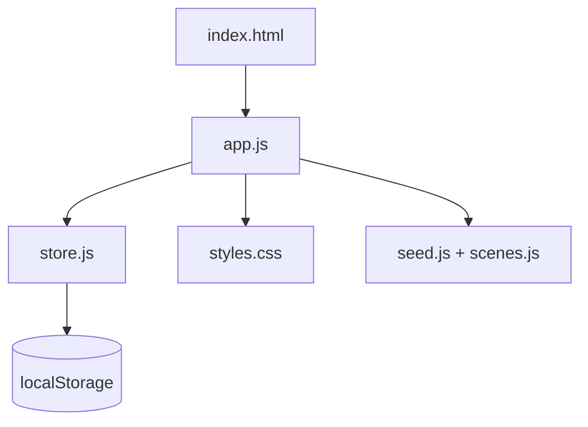

# SiteProof — Architecture

| | |
|---|---|
| **Product** | SiteProof: construction-site issue communication web app |
| **Course** | ESCP Digital Product Design, 2026–2027 |
| **Repository** | `ESCP-2627DT-A4` |
| **Status** | Functional browser prototype using fictional data |
| **Source of product truth** | `product.md`, supported by `design.md` and `evidence.md` |
| **Audience** | Project team, course reviewers, and agents building the prototype |

> **In one sentence:** SiteProof is a plain HTML, CSS and JavaScript web app that stores fictional defect records in one browser and demonstrates the hand-off: **report → assign → progress → review → close**.

## 1. Purpose, scope and constraints

This document explains how the SiteProof prototype is built. It complements `product.md`, which defines what the product does, and `design.md`, which defines the proposed interface and component states.

The architecture respects these constraints:

| Constraint | Architectural consequence |
|---|---|
| Functional web prototype | The repository contains a directly runnable browser app. |
| No external APIs or backend | No `fetch` calls, database, authentication service, analytics, CDN, or server-side application logic. |
| Fictional data only | Users, issues, locations and images are demo data stored in code. |
| Runs locally | Node.js is used only to serve the files, run tests and create the optional bundled file. |
| Same-browser role switching | Worker and manager views read the same `localStorage` issue dataset. Login is simulated. |
| Small and understandable | Plain JavaScript avoids framework setup that is not needed for this prototype. |

The prototype does not provide real authentication, production authorization, cross-device synchronization, notifications, BIM integration, legal acceptance, or emergency reporting.

## 2. Technology stack

| Layer | Choice | Purpose |
|---|---|---|
| Markup | HTML5 | App shell and accessible structure. |
| Styling | Plain CSS | Responsive layout, design tokens, cards, forms and status cues. |
| Behaviour | Browser JavaScript | Rendering, forms, role switching and workflow actions. |
| Persistence | `localStorage` | Keeps fictional issues after refresh in the same browser. |
| Active user | `sessionStorage` | Keeps the selected demo identity for the current tab. |
| Local tooling | Node.js 18+ and npm | Runs the local server, tests and bundling script. |
| Tests | Node’s built-in `node:test` runner | Checks the core status workflow without extra dependencies. |
| Build | `scripts/build-single-file.mjs` | Produces `dist/siteproof.html` with local CSS and JavaScript embedded. |

There is no React, TypeScript, Vite, React Router, Storybook package, or component library in the current implementation. `design.md` documents the intended component catalogue; a runnable Storybook catalogue remains a future implementation task if required by the course.

## 3. Repository structure

The prototype lives in the `siteproof/` folder of the GitHub repository:

```text
siteproof/
├── README.md                         # How to run and demonstrate the prototype
├── index.html                        # Browser entry point
├── package.json                      # Start, test and build commands
├── css/
│   └── styles.css                    # Design tokens and responsive UI styles
├── js/
│   ├── store.js                      # Seed data, persistence and status constants
│   ├── scenes.js                     # Fictional demo-image illustrations
│   ├── seed.js                       # Fictional demo users
│   └── app.js                        # Rendering, screens and interactions
├── tests/
│   └── workflow.test.js              # Core workflow tests
├── scripts/
│   └── build-single-file.mjs         # Creates dist/siteproof.html
└── dist/
    └── siteproof.html                # Optional self-contained build output
```

## 4. Runtime and data flow



`index.html` creates the app mount point and loads the local scripts in dependency order. `app.js` renders the current screen and calls the store for data changes. `store.js` loads seed issues on first use and saves changes under the `siteproof.demo.v1` key. `sessionStorage` stores the selected demo user under `siteproof.user`.

The browser is the only runtime. Opening the app in another browser or device creates a separate dataset.

## 5. Users and screens

The app uses simulated sign-in. Any password is accepted because this is not authentication.

### Worker experience

- **My work:** shows reports created by the worker and tasks assigned to the worker.
- **Report an issue:** captures title, type, location and description, with optional photo and cause.
- **Issue detail:** shows the original report, assignment, deadline, history and worker actions.

### Manager experience

- **Manager dashboard:** shows all fictional issues and their status, assignee and deadline.
- **Issue detail:** shows the original report and allows assignment, review, closure or rework.

Both roles can report defects in the product concept. Only the manager can assign responsibility, change the deadline, approve closure, or send work back.

## 6. Data model

Each issue contains:

```text
id              Readable identifier such as SP-0004
title           Short issue title
type            Damage, workmanship, installation or safety
location        Fictional building/floor/room context
description     What was observed
reportedBy      Demo user ID
assignee        Demo worker ID or null
status          New, Assigned, In progress, Ready for review, Rework needed, Closed
deadline        ISO date or null
photo           Fictional scene key
completionNote  Worker’s repair note, when submitted
history         Timestamped activity entries
```

The original report fields are retained in the issue history. A manager’s closure is an internal demo decision, not formal engineering or legal acceptance.

## 7. Workflow and status rules

```mermaid
stateDiagram-v2
  [*] --> New: Worker reports
  New --> Assigned: Manager assigns worker and deadline
  Assigned --> "In progress": Worker starts work
  "In progress" --> "Ready for review": Worker submits completion note
  "Ready for review" --> Closed: Manager approves
  "Ready for review" --> "Rework needed": Manager requests more work
  "Rework needed" --> "In progress": Worker starts again
```

“Overdue” is a flag for an open issue whose deadline has passed; it is not a status. The app keeps a visible activity history for reporting, assignment, progress, review and closure actions.

## 8. Persistence and limitations

- `localStorage` stores the fictional issue list and survives refreshes in the same browser profile.
- `sessionStorage` stores the selected demo user for the current tab.
- Browser storage is not a server and does not synchronize between devices.
- Large photos may exceed browser storage limits; demo images are lightweight illustrations.
- Reset demo data removes the local demo dataset and restores the seed issues.
- Anyone using the browser can select any demo user; this is not real security.

## 9. Accessibility and responsive design

The CSS uses a mobile-first layout, visible labels, readable status text, visible keyboard focus, and touch-friendly controls. Status is communicated with text as well as colour. Images have alt text, and form validation displays an explanatory message.

Before submission, manually check the app on a phone-width viewport and a desktop-width viewport, complete the workflow with the keyboard, refresh after changes, and confirm that only fictional data is used.

## 10. How to run

From the `siteproof/` folder:

```bash
npm start
```

Open `http://localhost:5173` in a browser. The app can also be opened directly through `index.html`, although a local server is recommended.

Run the tests:

```bash
npm test
```

Create the self-contained build:

```bash
npm run build
```

The build output is `dist/siteproof.html`.

## 11. Requirement traceability

| Product need | Prototype implementation |
|---|---|
| Report a defect | Worker report form in `app.js` |
| Record site context | Location field and fictional project data |
| Manager inbox | Manager dashboard |
| Assign responsibility and deadline | Manager assignment form |
| Track progress | Start work and status transitions |
| Submit completion | Worker completion note and review status |
| Verify or request more work | Manager close/rework actions |
| Traceable history | Issue history entries in `store.js` |
| Persistence | `localStorage` through the store |

